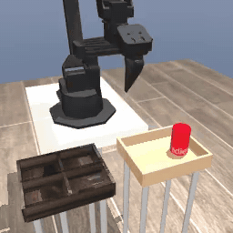
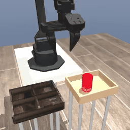

# Aloha-can-transfer

在 MuJoCo 中让 ALOHA 左臂（vx300s）完成 Can 的抓取、搬运和放置。项目包括动力学建模、关节控制器（C3 计算力矩控制）、经典规划器、robomimic 示范重定向、图像 Diffusion Policy（BC），以及 DSRL（在扩散模型的噪声空间中做 SAC 微调）。

## 效果演示

下面是 Diffusion Policy（BC）与 DSRL 微调后策略的完整 pick & place 过程。画面为 agentview 相机，10 fps，实时速度。

<table>
  <tr>
    <th></th>
    <th>Diffusion Policy（BC）</th>
    <th>DSRL（ckpt_best）</th>
  </tr>
  <tr>
    <td>同一初始位置<br>（评测种子 1）</td>
    <td><br>成功，16.6 s（<a href="media/dp_seed01.mp4">mp4</a>）</td>
    <td><br>成功，8.7 s（<a href="media/dsrl_seed01.mp4">mp4</a>）</td>
  </tr>
  <tr>
    <td>其他示例<br>（初始位置不同）</td>
    <td><br>评测种子 0，成功，12.7 s（<a href="media/dp_seed00.mp4">mp4</a>）</td>
    <td><br>验证种子 20000，成功，8.8 s（<a href="media/dsrl_val_seed20000.mp4">mp4</a>）</td>
  </tr>
</table>

在种子 0–49 上的正式评测（不录像）中，成功率分别为：BC（w = 0）36/50，DSRL 46/50，经典规划器 50/50。


## 1. 安装

要求：Linux，NVIDIA GPU，驱动需支持 CUDA 13.2；已安装 conda。

```bash
conda env create -f environment.yml        # 创建环境 AlohaPAP（Python 3.12，torch 2.15.0+cu132，mujoco 3.17.0）
conda run -n AlohaPAP python -m pip install -e .
conda run -n AlohaPAP python scripts/check_env.py      # 检查 CUDA、离屏渲染（EGL）与模型加载
```

- `pyproject.toml` 故意没有声明 torch，避免 `pip install -e .` 把 CUDA 版 torch 换成 CPU 版。torch 请只通过 `environment.yml` 安装。
- 离屏渲染用 EGL（`MUJOCO_GL=egl`），脚本内部已设置。

可选：运行测试。

```bash
conda run -n AlohaPAP python -m pytest tests -q -p no:cacheprovider
```

## 2. 不训练，先看效果

经典规划器加 C3 控制器，跑两组固定取放位置 × 三档速度，以及随机位置的成功率：

```bash
conda run -n AlohaPAP python -u scripts/m4_run.py
conda run -n AlohaPAP python -u scripts/m4_analyze.py
```

结果写到 `outputs/m4/`，包括 `summary.md`、`figures/` 和 `videos/`。

## 3. 最小训练流程

一共三步：示范数据 → BC → DSRL。每一步都先给出几分钟内能跑完的冒烟版本，再给出正式版本。

### 3.1 准备示范数据

下载 robomimic Can-PH v1.4.1 的 low_dim 数据（200 条人类示范），然后重定向到 ALOHA，并在仿真中重放筛选：

```bash
mkdir -p datasets/robomimic/can/ph
curl -L -o datasets/robomimic/can/ph/low_dim_v141.hdf5 \
  http://downloads.cs.stanford.edu/downloads/rt_benchmark/can/ph/low_dim_v141.hdf5

conda run -n AlohaPAP --no-capture-output python -u scripts/m5_generate.py            # 全部 200 条，约 9 分钟
# Smoke：只处理前 20 条
# conda run -n AlohaPAP --no-capture-output python -u scripts/m5_generate.py --limit 20
```

输出是 `outputs/m5/dataset/demos.hdf5`。完整运行约得到 120 条成功示范；BC 默认从中抽 30 条训练。

注意：输出目录固定为 `outputs/m5/`，重跑（包括 `--limit` 冒烟）会覆盖已有的数据集。

### 3.2 训练 Diffusion Policy

```bash
# Smoke（约 30 s）
conda run -n AlohaPAP --no-capture-output python -u scripts/m6_train.py \
  --config configs/m6_dp.yaml --out outputs/m6/smoke \
  --epochs 6 --warmup-epochs 0 --val-every 6 --n-val-episodes 1 --val-batches 2 --val-loss-every 1

# 正式（2000 epoch，RTX 5080 上约 1.1 h）
conda run -n AlohaPAP --no-capture-output python -u scripts/m6_train.py \
  --config configs/m6_dp.yaml --out outputs/m6/train

# 评测：种子 0–49；用 --out 指定评测目录（默认会为种子 0–3 录像）
conda run -n AlohaPAP --no-capture-output python -u scripts/m6_eval.py \
  --checkpoint outputs/m6/train/ckpt_last.pt --out outputs/m6/train/eval
```

`m6_eval.py` 每局随机抽取初始噪声，而且会录像，所以结果不能逐位复现。需要可复现的 BC 评测时，用第 3.3 节的 `m7_eval.py --method bc_zero` 或 `bc_seeded`，并加 `--videos none`。

### 3.3 DSRL 微调

冻结 BC，在 16×8 的初始噪声空间中训练 SAC。BC checkpoint 的路径在 `configs/m7_dsrl.yaml` 的 `bc_checkpoint` 中设置，也可以用 `--bc-checkpoint` 覆盖。

```bash
# Smoke（4 个并行环境、280 个转移，加载完成后约十几秒）
conda run -n AlohaPAP --no-capture-output python -u scripts/m7_train.py \
  --config configs/m7_dsrl.yaml --smoke --out outputs/m7/smoke/train

# 正式（2×10⁶ 环境转移，8 个并行环境，约 18 h）
conda run -n AlohaPAP --no-capture-output python -u scripts/m7_train.py \
  --config configs/m7_dsrl.yaml --out outputs/m7/train

# 评测：按验证选出的 ckpt_best，种子 0–49，不录像
conda run -n AlohaPAP --no-capture-output python -u scripts/m7_eval.py \
  --method bc_dsrl --bc-checkpoint outputs/m6/train/ckpt_last.pt \
  --actor-checkpoint outputs/m7/train/ckpt_best.pt \
  --seeds 0-49 --videos none --out outputs/m7/eval_bc_dsrl_best
```

## 4. 目录

| 路径 | 内容 |
|---|---|
| `aloha/`、`assets/scene/` | 机器人模型（Menagerie ALOHA，已修复），Can 场景（robosuite，MIT 许可） |
| `src/aloha_pp/` | `sim` 环境、`kin` / `dyn` 建模、`control` 底层控制、`planning` 规划器、`data` 示范、`policy` 扩散策略、`rl` DSRL |
| `configs/` | 各阶段配置 |
| `scripts/` | 实验、训练、评测、画图脚本 |
| `tests/` | 单元与回归测试 |
| `outputs/`、`datasets/` | 实验产物与数据 |

## 5. 说明

- 所有命令都应在 conda 环境中运行。`conda run` 默认会截获输出，长任务加 `--no-capture-output python -u` 才能实时看到日志。
- 训练和验证都支持 `--live-viewer`，可以实时弹出 MuJoCo 窗口，默认关闭；打开后训练会变慢。
- 评测成功率请不要和录像一起跑：在本机 GPU / EGL 下，录像会改变闭环轨迹。
