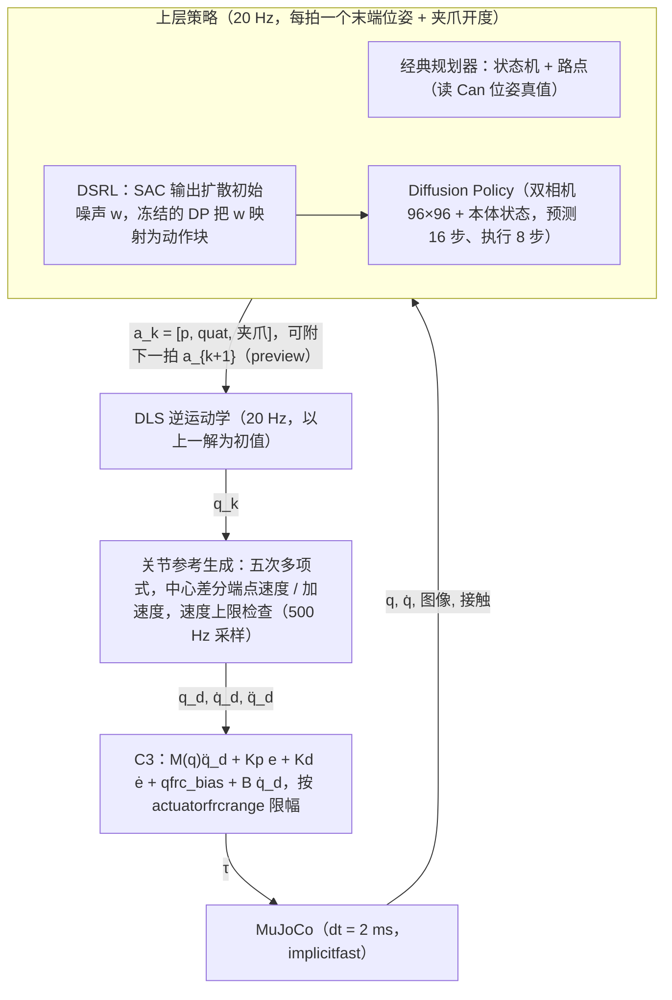
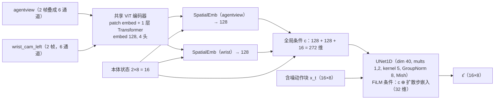

# ALOHA 左臂 Can 抓取—搬运—放置：建模、控制、规划与扩散策略强化学习技术报告

> 仓库：`Aloha-can-transfer`（Python 包 `aloha_pp`）。仿真：MuJoCo 3.17.0。
> 本报告汇总里程碑 M0–M7 的实现与实验结果。每个数值都对应 `outputs/` 下的实验产物，或 `tasks/` 下的交付与审查记录。插图由 `scripts/m8_figures.py` 从 `outputs/` 复制或绘制到 `report/figures/`，视频复制到 `report/videos/`；这两个目录都不入 git。
> 文中标“推测”的内容没有经过专门实验验证。

---

## 0. 摘要

我们在 MuJoCo 中让 ALOHA 左臂（Interbotix vx300s，6 个转动关节加平行滑轨夹爪）完成一项任务：从左侧料箱抓起一个 Can，搬到右侧料箱，放进指定的目标格。整套系统分四层，自下而上依次是：

1. **模型层**：在 Menagerie 的 ALOHA 模型上做了修复，包括力矩上限、执行器、阻尼和夹爪力上限；场景来自 robosuite 的 PickPlaceCan。自写正运动学、几何雅可比、阻尼最小二乘逆运动学、递推牛顿—欧拉逆动力学和质量矩阵，在 200 个随机构型上与 MuJoCo 对照，误差全部 ≤ 1.1×10⁻¹⁴（Christoffel 项为 6.3×10⁻¹³）。另外分析了关节耦合和腕部奇异。
2. **底层（500 Hz）**：20 Hz 的末端位姿指令先经逆运动学转成关节目标，再生成带前瞻的五次多项式关节参考，最后由计算力矩型控制器 C3 跟踪（惯性前馈、偏置补偿、阻尼前馈加 PD），输出按力矩上限限幅。两组取放位置 × 三档速度下，C3 的关节 RMSE 约 3 mrad；同条件下 PD（C1）和 PD + 重力补偿（C2）的 RMSE 是它的 2.4–8 倍。
3. **经典规划器**：状态机加路点，读取 Can 位姿真值。两组固定位置 × 三档速度共 6 组全部成功；随机初始位置的种子 0–49 成功 50/50，Wilson 95% 区间 [0.93, 1.00]，放置误差中位 4.5 mm。
4. **学习型上层**：
   - 把 robomimic Can-PH 的 200 条人类示范部分重定向到 ALOHA 上，得到 120 条成功示范。
   - 用其中 30 条训练图像 Diffusion Policy（BC）。
   - 冻结 BC，用 DSRL（在扩散模型的初始噪声空间里做 SAC）微调。

**主结果**：评测种子 0–49，随机初始位置，评测时不录像。

| 方法 | 成功 | Wilson 95% | 成功局放置误差中位 | 用时中位（全部局） |
|---|---|---|---|---|
| 经典规划器（M4 E2，读真值） | 50/50 | [0.93, 1.00] | 4.5 mm | 6.8 s |
| BC，w = 0（`bc_zero`） | 36/50 | [0.58, 0.83] | 5.4 mm | 12.7 s |
| BC，按种子固定的高斯噪声（`bc_seeded`） | 32/50 | [0.50, 0.76] | 5.3 mm | 13.6 s |
| **BC + DSRL，`ckpt_best`（事先声明的主结果）** | **46/50** | [0.81, 0.97] | 4.0 mm | 8.8 s |
| BC + DSRL，`ckpt_last` | 38/50 | [0.63, 0.86] | 8.1 mm | 7.95 s |

与两个 BC 基线做精确 McNemar 配对检验：`bc_seeded` → `best` 为 17 局提升、3 局退化，p = 0.0026；`bc_zero` → `best` 为 13 局提升、3 局退化，p = 0.021。`ckpt_last` 相对两个基线都不显著。

---

## 1. 系统总览

### 1.1 分层架构



- 一个控制拍是 50 ms，内含 25 个物理步。
- 所有上层输出的都是**机器人基座坐标系下的绝对 TCP 位姿**（xyz + 四元数 wxyz）加夹爪开度（m）。
- 所有上层共用同一套“逆运动学 → 参考生成 → C3”底层，因此规划器、BC 和 DSRL 的差别只来自上层。

### 1.2 软件环境

| 项 | 版本 |
|---|---|
| 操作系统 | Ubuntu 24.04.5 LTS |
| Python | 3.12.14（conda 环境 `AIControl`，`environment.yml`） |
| MuJoCo | 3.17.0；离屏渲染 `MUJOCO_GL=egl` |
| PyTorch | 2.15.0+cu132 |
| numpy | 2.5.4 |
| 硬件 | RTX 5080 16 GB（sm_120，驱动 595.99.02），16 核 CPU，约 31 GB 内存 |

项目不依赖 robosuite、robomimic、DPPO、DSRL 的安装包。需要的资产、数据格式和网络代码都复制进本仓库，并注明了来源与许可证（第 11 节）。

### 1.3 代码结构与里程碑

| 目录 / 文件 | 内容 | 里程碑 |
|---|---|---|
| `aloha/` | Menagerie ALOHA 模型及修复后的 motor / position 两版执行器 | M1 |
| `assets/scene/` | robosuite PickPlaceCan 的桌子、料箱、Can、相机（MIT 许可） | M1 |
| `src/aloha_pp/sim/` | 环境类（reset / step / 观测 / 成功判定），C3 环境装配 | M1, M3 |
| `src/aloha_pp/kin/`、`dyn/` | FK、雅可比、DLS IK；RNEA、M、C、g | M1, M2 |
| `src/aloha_pp/control/` | 五次参考流、速度限制、B0 / B1 / C1–C4、跟踪实验日志与统计 | M3, M4 |
| `src/aloha_pp/planning/` | 规划器状态机、时间表、任务指标、示范噪声 | M4, M5 |
| `src/aloha_pp/data/` | Can-PH 重定向、坐标映射、HDF5 数据集 | M5 |
| `src/aloha_pp/policy/` | ViT、UNet1D、DDPM / DDIM、Diffusion Policy、动作块执行 | M6 |
| `src/aloha_pp/rl/` | 噪声空间环境、SAC、非对称 critic、并行环境、评测与对比 | M7 |
| `scripts/m*_*.py` | 各阶段的实验、训练、评测、分析脚本 | M1–M8 |
| `tests/` | 单元与回归测试（M7 验收时本机 117 passed） | 全部 |

---

## 2. 仿真环境与机器人模型

### 2.1 机器人与模型修复

机械臂取 DeepMind MuJoCo Menagerie 的 ALOHA 左臂：6 个转动关节（waist、shoulder、elbow、forearm_roll、wrist_angle、wrist_rotate），加一个平行滑轨夹爪。Menagerie 的原始模型是为高增益位置伺服调出来的，直接用来做力矩控制和动力学分析会有几处问题。我们做了下面四项修改。

1. **删除重复的夹爪 equality 约束**：原模型两指耦合约束重复，`neq` 从 2 改为 1。
2. **关节力矩上限 `actuatorfrcrange`**：6 个臂关节分别为 waist 10、shoulder 20、elbow 20、forearm_roll 10、wrist_angle 10、wrist_rotate 4（N·m）。所有控制器都按这组上限限幅；position 版执行器的 `actuatorgravcomp` 力也计入上限。**这组数值是按 vx300s 舵机量级估的假设值，没有与真实舵机规格逐一核对。**
3. **两份执行器文件**：
   - motor 版（`aloha/actuators_motor.xml`）统一 `gear=1`，ctrl 就是关节力矩，ctrlrange 与力矩上限相同。C1–C4 用这一版。
   - position 版保留 Menagerie 的 kp，额外加 `kv`（取 Menagerie 原阻尼值），这个力同样计入力矩上限。B0 / B1 用这一版。
4. **关节阻尼**：
   - Menagerie 原值（shoulder 20、elbow 18.49 等）是配合高 kp 位置执行器调出来的，不是物理阻尼。按原值算，shoulder / elbow 在 20 N·m 下的稳态速度只有约 1 rad/s，达不到速度上限 2 rad/s，快速档必然饱和。
   - 我们改为让“速度上限下的阻尼力矩不超过力矩上限的约 25%”：waist 1.0、shoulder 2.0、elbow 2.0、forearm_roll 0.8、wrist_angle 0.8、wrist_rotate 0.3（N·m·s/rad）。例如 shoulder 为 2.0 × 2 = 4 N·m，是上限的 20%。
   - `armature`（shoulder 0.395、elbow 0.383、forearm_roll 0.14、wrist_angle 0.008）和 `frictionloss`（shoulder 2.0、elbow 1.15 N·m）保留原值。

**夹爪**：
- 执行器为 position 型，kp 2000，`forcerange` ±20 N，ctrlrange 0.002–0.037 m。ctrl 是单侧手指到中心的位移。
- 张开取 0.037。闭合取 0.015，小于 Can 半径 0.0225，所以闭合后手指持续施加夹持力，最大约 20 N。

**仿真参数**：步长 2 ms，积分器 `implicitfast`。控制频率 20 Hz，每个控制拍 25 个物理步。

**TCP**：专用 site `left/tcp`，位于夹爪张开时两指垫的中点，+X 为接近方向，+Y 为两指张开方向。逆运动学、误差统计、示范数据都以它为准。

### 2.2 速度上限

waist / shoulder / elbow 为 2.0 rad/s，forearm_roll / wrist_angle / wrist_rotate 为 3.0 rad/s。这组数值有意取得比硬件规格保守，用途是在轨迹生成时检查速度：超限就把时长拉长或制动（第 4.1 节）。它不作为策略输出的硬约束。

### 2.3 场景与 Can

- **资产**：地面、桌子、两个料箱、Can 和 agentview 相机都取自 robosuite v1.5.1 的 PickPlaceCan（MIT 许可，`assets/scene/LICENSE`），按 ALOHA 的工作空间重新布置。
- **料箱位置**：左料箱中心在基座系 (0.30, 0.125)；右料箱分成四格。两个料箱中心相距 0.25 m（robosuite 中为 0.53 m）。
- **Can 外形**：robosuite 的 Can 网格等比例缩放 0.90，直径 4.50 cm、高 7.21 cm。夹爪最大开口 5.74 cm，每侧余量 0.62 cm。
- **Can 碰撞几何**：
  - 网格直接做碰撞（方案 A）时，夹持下会慢慢陷入，3 s 滑移 8.86 mm。
  - 因此外观仍用网格，碰撞改为圆柱（方案 B）：半径 0.02251 m，半高 0.03604 m，密度 100，质量 11.5 g，摩擦系数 1，`condim=4`。换成圆柱后，抓起冒烟测试的滑移为 2.78 mm（M1 r2）。
  - Can 只有 11.5 g，对搬运段的力矩需求几乎没有影响（**推测**：这让搬运比真实罐装饮料轻松很多）。
- **相机**：agentview（场景外）和 `wrist_cam_left`（腕部），观测分辨率都是 96×96。


*图 2-1：agentview 相机 256×256 渲染（左料箱在机器人左侧，右料箱分格）。观测实际使用 96×96：*

| agentview 96×96 | 腕部相机 96×96 | 抓起冒烟测试 |
|---|---|---|
|  |  |  |

### 2.4 评测配置与成功判定

| 模式 | Can 初始位置（基座系，m） | 目标格中心 | 用途 |
|---|---|---|---|
| `fixed_1` | (0.30, 0.125) | 右料箱 +X+Y 格 (0.336, −0.080)，即 robosuite 原目标格 | 固定位置实验 |
| `fixed_2` | (0.27, 0.165) | 对角的 −X−Y 格 (0.264, −0.170) | 固定位置实验 |
| `random` | xy 在 [0.26, 0.34] × [0.07, 0.18] 内均匀采样（按 Can 半径内缩），由种子决定 | +X+Y 格 | 成功率评测、示范、训练 |

目标格的半尺寸为 3.24 cm × 4.14 cm，z 方向为 Can 静止中心高度 ±2 cm。

**成功判定**（`sim/success.py`）：以下条件同时满足，并且连续保持 250 个物理步（0.5 s）：

1. Can 中心在目标格内；
2. Can 线速度 < 1 cm/s；
3. **已松手**：两指都不与 Can 接触。

第 3 条是为了防止强化学习靠“一直夹着放在格里”拿到成功奖励。

**失败分类**（M6 起统一，按整局任务过程判定）：
- `not_grasped`：两指从未同时夹住 Can；
- `not_lifted`：夹住了但没抬起 2 cm；
- `dropped_after_lift`：抬起后两指连续 10 个物理步都失去接触，或 Can 掉落；
- `not_released`：到时没有松手；
- `outside`：松手了但 Can 不在目标格内。

---

## 3. 运动学与动力学建模

### 3.1 运动学参数

基座 `left/base_link` 固定在世界系中。各关节的轴向与零位偏移如下（`outputs/m2/kinematic_parameters.md`，零位时各子坐标系与父坐标系姿态相同）：

| 关节 | 子连杆 | 轴（子系） | 零位偏移（父系，m） |
|---|---|---|---|
| waist | shoulder_link | z | (0, 0, 0.079) |
| shoulder | upper_arm_link | y | (0, 0, 0.04805) |
| elbow | upper_forearm_link | y | (0.05955, 0, 0.3) |
| forearm_roll | lower_forearm_link | x | (0.2, 0, 0) |
| wrist_angle | wrist_link | y | (0.1, 0, 0) |
| wrist_rotate | gripper_link | x | (0.069744, 0, 0) |

结构上，waist 是竖直轴，shoulder、elbow、wrist_angle 三个俯仰轴互相平行；forearm_roll 与 wrist_rotate 都沿各自连杆的 +X 方向。

### 3.2 正运动学与几何雅可比

记 $T_{p(i)}^{i}(0)$ 为零位时子连杆 $i$ 相对父连杆的位姿，$\hat a_i$ 为关节轴（子系），则连杆 $i$ 在世界系中的位姿递推为：

$$
T_i(q) = T_{p(i)}(q)\; T_{p(i)}^{i}(0)\; \begin{bmatrix} R(\hat a_i, q_i) & 0\\ 0 & 1\end{bmatrix},\qquad
T_{\rm tcp}(q) = T_{\rm gripper}(q)\, T_{\rm gripper}^{\rm tcp}.
$$

夹爪两指按给定开度锁定，作为刚性附件并入 `gripper_link`。转动关节 $i$ 的世界系轴向为 $a_i = R_i \hat a_i$，原点为 $o_i$。TCP 的 6×6 几何雅可比按列写为：

$$
J(q) = \begin{bmatrix} a_1 \times (p_{\rm tcp}-o_1) & \cdots & a_6 \times (p_{\rm tcp}-o_6) \\ a_1 & \cdots & a_6 \end{bmatrix},\qquad
\begin{bmatrix} v_{\rm tcp}\\ \omega \end{bmatrix} = J(q)\,\dot q .
$$

实现见 `kin/fk.py`（`ArmChain.forward`、`tcp_jacobian`）。自写结果与 `mj_kinematics`、`mj_jacSite` 对照的误差见第 3.6 节。

### 3.3 腕部奇异

forearm_roll 与 wrist_rotate 都是局部 +X 转轴，两者之间只隔着绕局部 Y 轴的 wrist_angle。因此当 wrist_angle 为 π 的整数倍时两轴共线，在关节范围内只有 **wrist_angle = 0** 这一处。在该构型上：

- 雅可比最小奇异值 $\sigma_{\min}$ 为 3.9×10⁻¹⁹（roll = 0）和 1.2×10⁻¹⁷（roll = 1），理论条件数无穷大；
- 在 wrist_angle = 0.4 rad 处，$\sigma_{\min}$ = 0.072，条件数约 26。

home 构型的 wrist_angle = 1.46 rad，自上而下的抓取姿态远离奇异点。DLS 逆运动学的阻尼项（下一节）保证在奇异附近步长有界。


*图 3-1：最小奇异值和条件数估计随 wrist_angle 的变化。在 0 处，图中的约 10¹⁶ 是按分母下限 10⁻¹⁶ 截断的估计值，理论值为无穷大。*

### 3.4 阻尼最小二乘逆运动学

目标是基座系 TCP 位姿 $(p^\*, Q^\*)$，先换算到世界系。每次迭代：

- 位置误差 $e_p = p^\* - p_{\rm tcp}(q)$；
- 姿态误差 $e_r$：用 `mju_subQuat` 求出 TCP 系下的角速度型误差，再左乘 $R_{\rm tcp}$ 转到世界系，与 `mj_jacSite` 的转动行一致；
- 姿态行加权 $w_r = 0.4$：

$$
e=\begin{bmatrix}e_p\\ w_r e_r\end{bmatrix},\quad
\tilde J=\begin{bmatrix}J_p\\ w_r J_r\end{bmatrix},\quad
\Delta q = \tilde J^{\top}\left(\tilde J\tilde J^{\top} + \lambda^2 I\right)^{-1} e,\quad \lambda = 0.05 .
$$

```text
算法 1  DLS-IK（kin/ik.py: DlsIk.solve）
输入：目标 (p*, Q*)，初值 q0（上一控制拍的解）
q ← clip(q0)
for k = 1..80:
    计算 e, J̃；若 ‖e_p‖ ≤ 1e-4 m 且 ‖e_r‖ ≤ 1e-3 rad：返回成功
    Δq ← DLS 步；若 ‖Δq‖ > 0.8 rad，按比例缩到 0.8
    回溯线搜索：步长 s = 1, 1/2, …（最多 8 次），找到 cost(clip(q + sΔq)) < cost(q) 即接受
    若都不下降：q ← clip(q + 0.05Δq)
返回最后的 q，并标记是否收敛
```

设计取舍：

- 以上一时刻的解为初值，避免在多解分支之间跳变。
- 结果夹到关节范围内。
- 容差 1e-4 m / 1e-3 rad 是 M3 按跟踪精度预算确定的（`configs/m3_track.yaml`）。
- 实测：收敛率 1，单次中位 66 µs、最大 108 µs，位置残差最大 0.10 mm（M3 r2）。在任务中按控制拍去重统计，中位 88 µs、最大 258 µs（M4 r2）。

### 3.5 动力学模型

关节空间动力学写为：

$$
M(q)\ddot q + C(q,\dot q)\dot q + g(q) + B\dot q + \tau_{f}(\dot q) = \tau ,
$$

其中各项含义如下：

- $M(q)$ 包含转子惯量 armature：$M = M_{\rm link}(q) + {\rm diag}(I_a)$；
- $B$ 为黏性阻尼；
- $\tau_f$ 为库仑摩擦（`frictionloss`）。

这些项与 MuJoCo 中各量的对应关系（M2 逐项核实）：

| 物理项 | MuJoCo 中的位置 |
|---|---|
| $M(q)$（含 armature） | `mj_fullM` |
| $C\dot q + g$ | `qfrc_bias`（不含阻尼和摩擦） |
| $g(q)$ | 速度置零后的 `qfrc_bias` |
| $-B\dot q$ | `qfrc_passive` |
| $-\tau_f$ | `qfrc_constraint`（frictionloss 在 MuJoCo 中是约束力） |
| `mj_rne` | 含速度积和重力，**不含 armature** |

**递推牛顿—欧拉（RNEA）**：在世界系中实现（`dyn/rnea.py`），只读取 `ArmChain` 中的质量、质心、惯量和关节轴。

```text
算法 2  RNEA（世界系；返回 M q̈ + C q̇ + g，可选加 armature）
前向（基座 → 末端）：对每个刚体 i，父刚体为 p，r = x_i − x_p
    若 i 有转动关节（世界轴 a_i）：
        ω_i = ω_p + a_i q̇_i
        α_i = α_p + a_i q̈_i + ω_p × (a_i q̇_i)
    否则：ω_i = ω_p，α_i = α_p
    a_i^o = a_p^o + α_p × r + ω_p × (ω_p × r)          # 刚体原点加速度
反向（末端 → 基座）：c_i = R_i c_i^local
    a_i^c = a_i^o + α_i × c_i + ω_i × (ω_i × c_i)
    f_i += m_i (a_i^c − g)
    n_i += c_i × m_i (a_i^c − g) + I_i α_i + ω_i × I_i ω_i      （I_i = R_i I_i^c R_iᵀ）
    f_p += f_i；n_p += n_i + r × f_i
关节力矩：τ_j = a_jᵀ n_{body(j)} + I_{a,j} q̈_j
```

其余各项都由同一递推得到：

- $g(q)$：$\dot q = \ddot q = 0$；
- $C\dot q$：$\ddot q = 0$、重力置零；
- $M$ 的第 $j$ 列：取 $\ddot q = e_j$、$\dot q = 0$、重力置零，共做 6 次 RNEA；
- 另用各刚体的雅可比按动能公式构造一份 $M = \sum_i \left(m_i J_{v,i}^\top J_{v,i} + J_{\omega,i}^\top I_i J_{\omega,i}\right) + {\rm diag}(I_a)$，作独立校验（`M_energy`）；
- Coriolis 矩阵由 $M$ 的 Christoffel 符号构造：

$$
C_{ij} = \sum_k \tfrac12\left(\frac{\partial M_{ij}}{\partial q_k} + \frac{\partial M_{ik}}{\partial q_j} - \frac{\partial M_{jk}}{\partial q_i}\right)\dot q_k ,
$$

  其中 $\partial M/\partial q$ 用步长 1e-3 rad 的四阶中心差分。

### 3.6 与 MuJoCo 的交叉验证

验证设置：200 个随机构型，$q$、$\dot q$、$\ddot q$ 均匀采样；两种手指开度（0.037 和 0.015）；容差 1e-8。下表数值来自 M8 重跑 `scripts/m2_validate.py`，输出改写到临时目录，与 M2 交付 r2 的数值逐项相同。

| 项 | 最大绝对误差 | 最大相对误差 |
|---|---|---|
| FK 位置 / 姿态（世界系） | 4.4e-16 / 1.1e-15 | 9.2e-13 / 1.1e-15 |
| 几何雅可比 vs `mj_jacSite` | 1.1e-15 | 3.2e-11 |
| $M$ vs `mj_fullM` | 6.7e-16 | 1.0e-10 |
| $M$（按动能公式构造） | 4.4e-16 | 3.7e-12 |
| $g$ vs 零速 `qfrc_bias` | 5.3e-15 | 1.1e-12 |
| $C\dot q$ | 1.6e-15 | 2.4e-12 |
| RNEA vs `mj_rne` + armature·q̈ | 1.1e-14 | 4.3e-12 |
| RNEA vs $M\ddot q$ + `qfrc_bias` | 1.1e-14 | 1.2e-11 |
| `qfrc_passive` vs $-B\dot q$ | 0 | 0 |
| Christoffel $C\dot q$ | 6.3e-13 | 3.9e-11 |
| $\dot M - 2C$ 反对称性 | 1.1e-16 | — |

结论：自写模型与 MuJoCo 在机器精度上一致。最后一行验证了 $\dot M - 2C$ 为反对称矩阵，这是计算力矩控制稳定性分析常用的性质。

> 注：`outputs/m2/validation_errors.csv` 中 `g` 一行显示 `FAIL nonfinite`。这是 M2 复核阶段向 `gravity_torque` 注入 NaN、检验“非有限值必须判失败”时留下的文件，不是正常验证的结果。正常结果以上表为准。

另外两项与摩擦有关的事实：

- frictionloss 在静止受力时完全被约束力抵消：shoulder 为 −2.0、elbow 为 1.15 N·m，与 frictionloss 数值相同。
- 两指以 0.05 m/s 运动时，对臂关节偏置力的影响最大为 4.5e-4 N·m，可以忽略。

### 3.7 关节耦合分析

**惯性耦合。** 下图是典型构型下的归一化质量矩阵 $M_{ij}/\sqrt{M_{ii}M_{jj}}$：


*图 3-2：含 armature（左）与不含 armature（右）的归一化质量矩阵。*

- 含 armature 时，主要的非对角耦合为：waist–wrist_rotate −0.39、waist–forearm_roll 0.21、elbow–wrist_angle 0.20、shoulder–elbow 0.16。
- 不含 armature 时，shoulder–elbow 升到 0.50，elbow–wrist_angle 0.48，waist–forearm_roll 0.73。
- armature 在对角线上的量级大于连杆惯量（例如 shoulder：armature 0.395，home 处 $M_{ii}$ = 0.649），明显削弱了归一化耦合。

home 构型下的对角元为 [0.119, 0.649, 0.531, 0.153, 0.021, 0.0026] kg·m²，它们就是第 4.2 节计算增益时用的 $M_{ii}$。

**耦合随构型的变化**（M2 r2，E1）：

- **沿 shoulder 扫描时系数不变**：shoulder–elbow、shoulder–wrist_angle、elbow–wrist_angle 三对都是常数（最大偏差 2.2e-16）。原因是这三对关节都在 shoulder 及其下游，绕 shoulder 轴转动只是把整个子树刚性旋转，相对几何不变。
- **沿 elbow 扫描时 elbow–wrist_angle 不变**，理由相同。
- **真正随构型变化的是 wrist_angle**：沿 wrist_angle 全范围扫描，含 armature 时 shoulder–wrist_angle 从 −0.226 变到 +0.412，elbow–wrist_angle 从 −0.014 变到 +0.393；在 elbow × wrist_angle 平面上，shoulder–wrist_angle 的范围是 [−0.256, +0.482]。

| | |
|---|---|
|  |  |

*图 3-3：耦合系数沿 wrist_angle 的变化（左），以及 elbow × wrist_angle 平面上的 shoulder–wrist_angle 耦合（右）。*

**单关节驱动时的耦合力矩。** 实验设置：只让 shoulder 或 elbow 沿 0.5 rad 的五次轨迹运动，其余关节保持静止，计算各被动关节需要多少力矩才能保持不动。设两档速度：1 s（峰值 0.94 rad/s）和快速档 0.469 s（峰值恰为 2 rad/s）。

去掉重力后的动态耦合项为 $M_{ij}\ddot q_j + $ 科氏 / 离心项。时间缩放 $1/0.46875$，动态项按其平方放大，理论倍数 4.55，实测也是 4.55。

| 主动关节 | 被动关节 | 1 s 峰值（N·m） | 占上限 | 快速档峰值（N·m） | 占上限 |
|---|---|---:|---:|---:|---:|
| shoulder | elbow | 0.31 | 1.5% | 1.40 | 7.0% |
| elbow | shoulder | 0.25 | 1.3% | 1.14 | 5.7% |
| elbow | wrist_angle | 0.07 | 0.7% | 0.31 | 3.1% |
| shoulder | wrist_angle | 0.04 | 0.4% | 0.18 | 1.8% |

**主动关节自身的力矩**：

- 1 s 档以重力为主：shoulder 5.92 N·m（30%），elbow 4.32 N·m（22%）。
- 快速档 shoulder 峰值 10.84 N·m（54%），在 t = 0.389 s 时分解为：$M_{ii}\ddot q$ −8.25、$g$ −5.86、$B\dot q$ +1.27、摩擦 +2.00。
- 各分项峰值不同时出现，不能直接相加。

| | |
|---|---|
|  |  |

*图 3-4：快速档 shoulder 单关节运动的力矩分解（左），以及去掉重力后的动态耦合（右）。*

**结论**：在本项目的速度范围内，关节力矩主要来自重力和自身惯性；被动关节受到的动态耦合不超过力矩上限的 7%。不过 C1 / C2 这类不含模型前馈的控制器，仍要靠反馈去抵消这部分耦合，第 4 节会看到它的影响。

---

## 4. 底层：参考生成与关节控制

### 4.1 20 Hz 指令到 500 Hz 关节参考

上层每 $T$ = 50 ms 给出一个 TCP 目标，逆运动学把它转成关节结点 $q_k$。底层需要在每个 2 ms 物理步上给出 $q_d$、$\dot q_d$、$\ddot q_d$，并且三者必须是同一条轨迹的各阶导数，否则惯性前馈会和位置参考对不上。

**段内五次多项式**（`control/quintic.py`）：相邻结点之间用一段五次多项式连接，两端位置、速度、加速度都给定。记 $s = t/T \in [0,1]$：

$$
q(s) = q_0 + v_0 T s + \tfrac12 a_0 T^2 s^2 + c_3 s^3 + c_4 s^4 + c_5 s^5,
$$

$$
\begin{aligned}
A &= q_1 - q_0 - v_0T - \tfrac12 a_0T^2,\quad
B = v_1T - v_0T - a_0T^2,\quad
C = a_1T^2 - a_0T^2,\\
c_3 &= 10A - 4B + \tfrac12 C,\quad c_4 = -15A + 7B - C,\quad c_5 = 6A - 3B + \tfrac12 C .
\end{aligned}
$$

**端点速度和加速度取中心差分（lookahead 方案）**：

$$
v_k = \frac{q_{k+1}-q_{k-1}}{2T},\qquad a_k = \frac{q_{k+1}-2q_k+q_{k-1}}{T^2}.
$$

两种工作模式：

- **等待模式**：上层逐拍下发、不提供未来目标。底层要多缓存一个结点才能算出中心差分，时刻 $kT$ 下发的结点在 $(k+2)T$ 才被参考追上，总滞后 100 ms。
- **preview 模式**：上层在下发当前目标的同时传入下一拍目标 `next_action`，中心差分立即可用，滞后降为 50 ms。规划器传入时间表中的下一拍。Diffusion Policy 在动作块内传下一步；执行段最后一步（第 8 步）传动作块的第 9 步。

**方案选择**（M3 r2 实测，C3、fixed_1）：

- 端点加速度强制为 0 的旧方案（r1）在每段内激起加速度纹波，fast 档肩部力矩指令峰值达 64.6 N·m。
- 中心差分方案把纹波从 12.53 降到 4.00（段内 $\ddot q$ 相对两端线性插值的 RMS），肩部峰值降到 26.6 N·m。
- 只用当前结点的因果方案（causal）滞后更小，但五次式在段内仍会鼓起，fast 档峰值回到 66.6 N·m，因此没有采用。

**速度上限与制动**：

- 每段生成后检查峰值速度。超限的段缩短位移，或改为制动。
- 制动段的进入速度与上一段相同，所以链条保持 $C^1$；起点已在上限上的段也能停下或反向。
- 任务实验和示范中，超限标记全部为 0。

**速度档**（`control/reference.py`）：

- **fast**：在 20 Hz 网格上，参考流不触发在线限速的最短总时长；
- **medium**：fast 每段的拍数 × 2；
- **slow**：fast 每段的拍数 × 4。

三档走同一条空间路径，只是时间缩放。M3 跟踪轨迹各档的时长和关节峰值速度比如下：

| 位置 | fast | medium | slow | fast 峰值速度 / 上限 |
|---|---|---|---|---|
| fixed_1 | 2.35 s | 4.70 s | 9.40 s | 0.952 |
| fixed_2 | 3.65 s | 7.30 s | 14.60 s | 0.993 |

### 4.2 控制器

所有控制器的输出都按 `actuatorfrcrange` 限幅。记 $e = q_d - q$、$\dot e = \dot q_d - \dot q$。

| 编号 | 控制律 | 说明 |
|---|---|---|
| B0 | MuJoCo position 执行器：$\tau = k_p(q_d - q) - k_v\dot q$ | Menagerie 官方 kp，有重力：用来看重力下垂 |
| B1 | B0 + `gravcomp` / `actuatorgravcomp` | 理想重力补偿的参照 |
| C1 | $\tau = K_p e + K_d \dot e$ | 自写 PD |
| C2 | $\tau = K_p e + K_d \dot e + g(q)$ | $g(q)$ 取速度置零后的 `qfrc_bias`（MuJoCo）；自写 RNEA 与之相差 ≤ 5.3e-15 |
| **C3** | $\tau = M(q)\ddot q_d + K_p e + K_d \dot e + \underbrace{C(q,\dot q)\dot q + g(q)}_{\texttt{qfrc\_bias}} + B\dot q_d$ | **主控制器**：惯性前馈 + 偏置补偿 + 阻尼前馈 |
| C4 | C2 + $K_i\!\int e\,dt$，条件积分抗饱和 | 用来说明接触时为什么不用积分 |

**增益**：各关节按 home 构型（夹爪张开）的 $M_{ii}$（含 armature）设成临界阻尼的二阶系统：

$$
K_{p,i} = M_{ii}\,\omega^2,\qquad K_{d,i} = 2\zeta M_{ii}\,\omega,\qquad \omega = 20\ {\rm rad/s},\ \zeta = 1;\qquad K_{i,i} = K_{p,i}\,\omega/10\ (\text{仅 C4}).
$$

由此得到 $K_p$ = [47.8, 259.5, 212.3, 61.0, 8.41, 1.04]，$K_d$ = [4.78, 25.9, 21.2, 6.10, 0.84, 0.10]。C1–C4 使用同一组 $K_p$、$K_d$。

**C3 的闭环误差动力学**。C3 用的 $M(q)$ 是当前构型的完整质量矩阵，这一点与增益计算时用的 home 构型对角元不同。若前馈模型准确，代入动力学方程可得：

$$
M(q)\left(\ddot e\right) + K_d\dot e + K_p e = \tau_f(\dot q) + B(\dot q - \dot q_d) + \text{限幅误差},
$$

即各关节近似解耦为 $\ddot e + 2\zeta\omega\dot e + \omega^2 e \approx$ 扰动 / $M_{ii}$。剩余的扰动主要来自两处：

- **库仑摩擦**：在静止附近形成一个“摩擦带”，稳态误差上界约为 $|e| \lesssim \tau_f / K_p$。shoulder 为 2.0 / 259.5 ≈ 7.7 mrad，elbow 为 1.15 / 212.3 ≈ 5.4 mrad。这与实测 C3 最大关节误差约 8 mrad 一致（第 4.4 节）。
- **力矩限幅**。

C3 不用积分项。原因见 C4 的接触实验：积分在接触时会饱和；主流机械臂控制框架通常也不用积分。

**C4 的条件积分**：在线计算未限幅的力矩。若某关节已经超出力矩范围，且误差方向还在往外推，就冻结该关节的积分。积分力矩本身也限在力矩范围内。

**C2 与 B1 的结构一致性检查**：

- 让 C2 改用 Menagerie 的 kp / kv，阻尼写成 $-k_v\dot q$（实验名 `C2_menagerie_noff`）。它与 B1 的关节 RMSE 为 39.33 和 39.46 mrad，轨迹最大差 1.10e-3 rad。
- 在 B1 的同一个状态上比较两者的力矩，差值为 1.8e-15 N·m。
- 从这个状态各积分一步，位置差 1.06e-6 rad。这个差别来自 `implicitfast` 对 position 执行器阻尼做隐式处理，motor 版的 $-k_v\dot q$ 则是显式的；与重力项无关。

### 4.3 跟踪实验设计

**参考轨迹**：基于笛卡尔路点，每段用五次时间律，相邻路点处速度为 0，姿态自上而下、yaw = atan2(y, x)。路点依次为：

1. home
2. Can 上方 8 cm
3. 抓取高度
4. 抬起 10 cm
5. 目标格上方
6. 放置高度
7. 抬起
8. home

到达后保持 0.5 s。这组实验只测跟踪性能，夹爪不开合，手指与 Can 的接触步数全部为 0，Can 最大位移 ≤ 6.3 µm。

**实验矩阵**：

- 主实验：2 组位置 × 3 档速度 × 6 个控制器 = 36 组；
- 另加 Menagerie 增益的 C2、C2 与 B1 的结构对照、C2 / C4 接触实验，共 40 组。

每组按统一格式记录日志：时间、$q$、$\dot q$、$q_d$、$\dot q_d$、$\tau$、饱和标记、TCP 位姿与参考、Can 位姿、手指接触。统计和绘图脚本只读日志（`scripts/m3_run.py`、`m3_analyze.py`）。

**指标**：

- 关节 RMSE / 最大误差：对全部关节和全部物理步的 $q - q_d$ 求 RMS 或最大绝对值；
- TCP 误差：分两种，相对原始笛卡尔参考的含参考滞后，相对 $FK(q_d)$ 的只反映关节环；
- 稳态误差：保持段的平均绝对误差；
- 饱和占比：关节 × 物理步中打到力矩上限的比例；
- 速度超限占比。

### 4.4 跟踪结果

**关节 RMSE（mrad）**，来自 `outputs/m3/summary.csv`：

| 控制器 | f1 fast | f1 medium | f1 slow | f2 fast | f2 medium | f2 slow |
|---|---:|---:|---:|---:|---:|---:|
| B0 | 60.9 | 40.7 | 25.7 | 63.2 | 39.1 | 23.8 |
| B1 | 60.0 | 39.5 | 23.6 | 62.4 | 37.8 | 21.6 |
| C1 | 23.6 | 18.9 | 15.1 | 21.4 | 17.0 | 14.3 |
| C2 | 21.5 | 14.8 | 9.6 | 18.7 | 12.7 | 8.2 |
| **C3** | **2.99** | **3.21** | **3.42** | **2.92** | **3.22** | **3.40** |
| C4 | 23.7 | 15.9 | 9.0 | 20.2 | 13.2 | 7.4 |


*图 4-1：各控制器关节 RMSE 随速度档的变化。*

**分析**：

1. **C3 的误差与速度基本无关**（约 3 mrad），最大误差约 8 mrad。这正好是 shoulder 摩擦带的宽度 $\tau_f/K_p$ ≈ 7.7 mrad。说明惯性前馈和偏置补偿把动态误差基本消除了，剩下的主要是摩擦造成的稳态误差。
2. **C1 / C2 的误差随速度增大**：动态项 $M\ddot q_d + C\dot q$ 只能靠反馈去抵消。C2 在 slow 档下比 C1 好约 1/3，这一部分是重力补偿的贡献。
3. **B0 / B1 的误差最大**（25–63 mrad）。它们的位置伺服没有速度参考项（$-k_v\dot q$ 而不是 $k_v\dot e$），运动中一直有相当于 $k_v\dot q_d / k_p$ 的滞后。B1 去掉了重力下垂，所以稳态误差小于 B0：fixed_2 slow 的保持段关节平均误差从 7.2 降到 1.3 mrad。
4. **C3 的 TCP 误差**：相对 $FK(q_d)$ 的 RMSE 为 2.4–3.1 mm。相对原始笛卡尔参考，在等待模式下为 12.1 / 21.0 / 36.4 mm（fixed_1 slow / medium / fast），这部分几乎全是 100 ms 参考滞后造成的，不是关节环的误差。preview 模式下这一项约减半（第 5.4 节）。


*图 4-2：fixed_1 fast 档各控制器的关节误差范数和力矩范数。C3 的误差一直贴近 0，代价是力矩曲线上有更多高频成分，即惯性前馈 $M\ddot q_d$ 带来的段间纹波。*

**力矩饱和**：

- medium、slow 档下，C3 在六组实验中都没有饱和。
- fast 档下，fixed_1 肩部饱和 4.95%、肘部 0.68%（按关节平均为 0.94%）；fixed_2 肩部 0.89%、肘部 0.24%。
- fixed_1 fast 的 $\ddot q_d$ 峰值为：肩 30、肘 35、腕摆 56 rad/s²。加上偏置和 PD 之后，肩、肘的力矩指令峰值为 26.6 和 21.4 N·m，超过 20 N·m 的上限。

这说明**只限制关节速度不足以避免力矩饱和**。我们没有为此加加速度上限，而是在报告中如实记录，并把 medium 档设为默认档：随机评测和示范生成都用 medium。

**跟得住的范围**（M3 结论）：在 medium 及更慢的档位，峰值速度约为上限的一半，力矩余量约 40%，100 ms 滞后对应的 TCP 误差预算约 21 mm。策略输出的动作频率和幅度都在这个范围内。

| | | |
|---|---|---|
|  |  |  |

*图 4-3：B0 的重力下垂（左）；C2 与 B1 的对照（中）；C4 接触实验（右）。*

**C4 接触实验**：TCP 先移到左料箱底面某点 (0.24, 0.08) 的上方，然后参考指令压到底面以下 1 cm，保持 2 s 后抬起。这个目标不可达，夹爪会与料箱底面持续接触。

- C2：误差停在 PD 与接触力平衡的位置，不饱和，手指与 Can 无接触。
- C4：积分持续累积，把肩部顶在力矩上限上（饱和占比 8.5%），关节偏离参考，手指与 Can 接触 32 步，把 Can 推开 43 mm。

这就是主控制器 C3 不用积分项的直接原因。放置误差中摩擦带造成的那一部分，应当由上层闭环修正，而不是靠底层积分（第 5.5 节）。

---

## 5. 经典规划器与任务实验

### 5.1 状态机与路点

规划器（`planning/planner.py`、`schedule.py`）是有特权的基线：reset 后读取 Can 位姿真值，瞄准当前模式的目标格中心，不加任何噪声。它一共 15 个状态：

```text
approach → pregrasp → descend → wait_close → close → dwell_closed → lift → carry
→ descend_place → wait_open → open → dwell_open → retreat → return → wait_success
```

各状态的路点和时长如下：

| 状态 | 位姿 / 夹爪 | 时长 |
|---|---|---|
| approach | home → Can 正上方 8 cm | 运动段（随速度档缩放） |
| pregrasp | 保持 | 0.10 s |
| descend | 降到抓取高度（TCP 与 Can 中心等高） | 运动段 |
| wait_close | 保持 | 1 拍滞后 + 0.25 s |
| close | 夹爪线性闭合到 0.015 | 12 拍 |
| dwell_closed | 保持 | 0.40 s |
| lift | 抬起 10 cm | 运动段 |
| carry | 移到目标格上方 | 运动段 |
| descend_place | 下降到放置高度 | 运动段 |
| wait_open | 保持 | 1 拍 + 0.25 s |
| open | 夹爪线性张开 | 12 拍 |
| dwell_open | 保持 | 0.20 s |
| retreat、return | 抬起，回 home | 运动段 |
| wait_success | 保持 | 2.0 s |

关键设计：

- **姿态**：自上而下抓取。yaw 选 0 或 π/2，让张开的两指朝向左料箱内余量更大的方向；抓到后保持同一个 yaw 直到放下，避免增益较低的腕部在持物时扭转。
- **等待后再开合夹爪**：在抓取和放置路点，要先等参考滞后（preview 模式下 1 拍）再加 0.25 s 稳定时间（约 $5/\omega$），然后才开合夹爪。
- **抓取后重新瞄准**：闭合结束时测量 Can 中心相对 TCP 的偏移 $\delta$，据此重建搬运段之后的路点，让 Can 中心（而不是 TCP）落在目标格中心上方 6 mm。实现上，TCP 放置点取为格中心 + (0, 0, 6 mm) − $\delta$，且不低于格中心以上 3 mm。
- **时间表**：运动段按路径长度分配拍数（姿态变化按 0.15 m/rad 折算为长度），段内用五次时间律。fast 档同样搜索最短可行总拍数，medium / slow 为 ×2 / ×4。夹爪的等待、斜坡和停留时长在三档中都相同。
- **preview 与命令提前一拍**：每拍同时下发当前目标和下一拍目标（preview 模式）；命令比规划器时间律提前一拍，用来抵消 50 ms 的参考滞后。因此 E1 / E2 中“TCP 相对参考”的误差与 E4 的口径不同，比较滞后只看 E4。
- **掉落判定**：Can 低于抓取高度 3 cm，或两指连续 10 个物理步都与 Can 无接触且 Can 仍在格中心以上 2 cm，判为掉落。只有一指失去接触不算。

### 5.2 E1：两组取放位置 × 三档速度

C3 控制器，`outputs/m4/summary.csv`：

| 位置 | 速度 | 运动时长 | 成功 / 完成时刻 | 关节 RMSE | 关节最大误差 | 力矩峰值 | 饱和 | 放置误差 xy | 夹持滑移 |
|---|---|---:|---|---:|---:|---:|---:|---:|---:|
| fixed_1 | fast | 2.7 s | 成功 / 4.72 s | 2.84 mrad | 7.98 mrad | 16.8 N·m | 0 | 3.8 mm | 2.3 mm |
| fixed_1 | medium | 5.4 s | 成功 / 6.71 s | 3.18 | 7.92 | 10.0 | 0 | 4.6 | 1.4 |
| fixed_1 | slow | 10.8 s | 成功 / 10.72 s | 3.36 | 7.86 | 8.35 | 0 | 5.4 | 1.1 |
| fixed_2 | fast | 4.0 s | 成功 / 5.67 s | 3.06 | 8.03 | 14.4 | 0 | 4.0 | 2.8 |
| fixed_2 | medium | 8.0 s | 成功 / 8.62 s | 3.28 | 7.90 | 9.09 | 0 | 4.7 | 1.7 |
| fixed_2 | slow | 16.0 s | 成功 / 14.52 s | 3.42 | 7.85 | 7.73 | 0 | 5.8 | 1.5 |

说明：

- 放置误差是成功时 Can 中心到目标格中心的水平距离。
- 6 组全部成功，且都没有力矩饱和。任务轨迹的 fast 档在路点之间有等待和停留，所以加速度尖峰比 M3 连续轨迹小；fixed_1 fast 的力矩峰值为 16.8 N·m（上限 20）。
- 速度越快，力矩峰值越大，夹持滑移也越大；但关节 RMSE 基本不变（约 3 mrad），与 M3 的结论一致。
- **放置误差反而随速度变慢而略增**（3.8 → 5.4 mm）。M4 r2 拆分发现：slow 档松手后、两指脱离过程中，Can 的水平位移有 2.5–2.7 mm。这部分没有在零摩擦条件下重测。

| | |
|---|---|
|  |  |

*图 5-1：E1 的 TCP 路径（左）和三档速度的对比（右）。*


*图 5-2：fixed_1 medium 一局的详细曲线。从上到下依次为：关节 $q$ 与 $q_d$（实线与虚线几乎重合）；力矩指令，细横线是各关节的力矩上限；夹爪开度与指令，闭合后开度停在约 0.029 m，被 Can 撑住；状态机状态。*

### 5.3 E2：随机初始位置成功率

使用 medium 档、random 模式，种子 0–49：

- 成功 **50/50**，Wilson 95% 区间 [0.929, 1.000]。
- 放置误差最小 2.4 mm、中位 4.5 mm、最大 4.8 mm。
- episode 时长 6.05–9.35 s，中位 6.8 s。
- 关节 RMSE 3.1–3.3 mrad；力矩峰值 9.7–11.5 N·m，全程无饱和。

需要说明：`random_can` 的采样只按 Can 半径内缩，没有抽到贴壁的困难初始位置，所以 50/50 不代表在任意位置都能成功。


*图 5-3：E2 的 Can 初始位置与最终放置位置。*

### 5.4 E4：preview 与等待模式对比

在 M3 的跟踪轨迹上，对比 C3 在 preview 与等待两种模式下的表现：

| 位置 / 档 | TCP 相对参考 RMSE：等待 → preview | $\ddot q_d$ RMS 比（preview / 等待） |
|---|---|---|
| fixed_1 fast / medium / slow | 36.4 → 19.3 / 21.0 → 11.4 / 12.1 → 7.2 mm | 1.009 / 1.005 / 1.003 |
| fixed_2 fast / medium / slow | 32.5 → 16.9 / 18.1 → 9.8 / 10.3 → 6.2 mm | 1.006 / 1.003 / 1.002 |

preview 把参考滞后从 100 ms 降到 50 ms，TCP 相对参考的误差约减半，参考的加速度纹波几乎不变。规划器、示范生成和学习策略都用 preview 模式。


*图 5-4：preview 与等待模式的 TCP 误差和关节参考加速度对比。*

### 5.5 放置误差的来源

放置误差约 4.5 mm。最初以为来自 Can 松手后的下落，后来做了零摩擦消融，结论被纠正：

- 只在内存中把 shoulder / elbow 的 frictionloss 置零，模型文件不改，跑 E1 两组 medium。
- 松手时肩 / 肘的 $q - q_d$ 从 −6.7 / −4.5 mrad 降到 0.15 / 0.13 mrad。
- 最终放置误差从 4.6–4.7 mm 降到约 0.5 mm，两组都仍然成功。

所以放置误差**主要来自肩、肘在摩擦带内的稳态误差**（$\tau_f/K_p$，第 4.2 节）。剩下约 0.5 mm 来自下落和重新瞄准，没有再细分。C3 不加积分项是有意的设计（第 4.4 节）；需要更精确放置时，应由上层基于观测做闭环修正。

---

## 6. 示范数据：robomimic Can-PH 的部分重定向

### 6.1 数据来源

使用 robomimic Can-PH v1.4.1 的 `low_dim` 数据集：200 条人类遥操作示范，Panda 机械臂，sha256 `6ce6e6c7…8cdd`。用 h5py 直接读取，只取 `robot0_eef_pos/quat`、夹爪手指位置和 Can 位姿，不安装 robosuite。原始的 OSC 增量动作全部丢弃。

### 6.2 为什么不能整条照搬

两边的几何差别很大：

- **料箱间距**：robosuite 中两个料箱中心相距 0.53 m，本项目只有 0.25 m。
- **目标格**：本项目的目标格只有 6.5 cm × 8.3 cm。
- **松手方式**：人类示范在 Can 还高出目标格约 0.24 m（中位）时就松手，让 Can 掉进很大的格子；落点距格中心中位 4.6 cm，这在本项目的格子里会掉出去。
- **机器人差异**：Panda 与 ALOHA 的工作空间、速度能力不同。

因此采用**“部分重定向 + 合成放置”**：保留人类示范在抓取前的相对运动和搬运中的残差运动，其余部分（接近、放置、姿态、夹爪时序）由程序合成。

### 6.3 重定向流程

```text
算法 3  单条示范的重定向（data/retarget.py）
1. 分段：用夹爪开度（两指位置绝对值之和）判断抓取和松手。
   闭合阈值 0.055，至少连续 8 帧，以排除 reset 时的短暂闭合。
2. 坐标映射（data/frames.py）：
   - Can 初始位置按它在源料箱内的相对比例，映射到本项目左料箱内；
   - 两边的目标格都是各自料箱的同一象限，所以目标格之间是刚性平移，R = I。
3. 位置：
   - 抓取前：TCP 位置 = 人类 TCP 相对 Can 的偏移 + 本项目 Can 的位置；
   - 搬运：从源示范中去掉“抓取点 → 松手点”的直线平移，只保留残差，
     叠加到“本项目抓取点 → 松手点”的 smoothstep 基线上；
     中段若低于 0.10 m，用正弦包络抬高，以越过料箱壁；
   - 松手前：先平移到格中心上方，再下降到“格中心 + 抓取偏移 + 6 mm”处，松手，然后撤离 8 cm。
4. 姿态：全部改为自上而下，yaw 由 choose_yaw 决定（与规划器相同）。
5. 接近段：从 home 出发的五次多项式，原始时长 0.5 s。
6. 按段放慢：对每个运动段分别搜索放慢系数，使 preview 参考流的关节速度峰值 ≤ 0.5·v_max；
   相邻段的系数在边界两侧各 5 个采样内用五次式过渡。
7. 插入夹爪块（放慢之后插入，时长不随放慢系数变化，与规划器相同）：
   1 拍滞后 + 0.25 s 等待、12 拍斜坡、闭合后停留 0.40 s、张开后停留 0.20 s。
8. 离线 IK 检查：位置误差 > 2 mm 判为 ik_unreachable，不执行。
9. 闭环执行：以 preview 模式在 ALOHA 上执行，同时渲染双相机 96×96；只保留通过成功判定的示范。
```

**动作约定**：动作是基座系绝对 TCP 位姿加夹爪开度，共 8 维：$[x, y, z, q_w, q_x, q_y, q_z, g]$。与规划器相同，动作比时间律提前一拍。

### 6.4 结果

| 指标 | 数值 |
|---|---|
| 重定向成功 | **120 / 200 = 0.60** |
| 失败原因 | not_lifted 41、ik_unreachable 32、dropped_after_lift 7 |
| 示范时长 | 9.7–15.5 s，中位 12.1 s（194–309 拍） |
| 参考关节速度峰值 / 上限 | 最大 0.5000，超限标记 0 |
| 20 Hz 实际关节速度峰值 / 上限 | 最大 0.498 |
| 放慢系数中位（接近 / 人类抓取前 / 搬运） | 4.65 / 1.00 / 1.11 |
| `human_fraction`（含人类成分的拍数比例）中位 | 0.486 |
| 生成与回放的一致性 | float64 状态逐位一致（恢复 `qacc_warmstart`） |
| 保底数据 | 规划器加噪声的示范 8 条，单独存放，未参与训练 |

关于失败原因：

- `not_lifted` 失败组的抓取几何与成功组重叠，原因没有查明。
- `ik_unreachable` 主要出现在搬运段：人类残差把 TCP 带出了 ALOHA 的可达区域。

| | | |
|---|---|---|
|  |  |  |
|  |  |  |

*图 6-1：重定向失败原因、示范时长、各段放慢系数（上排）；Can 初始位置、放置位置、人类成分比例（下排）。*

### 6.5 数据集格式

数据集为 `outputs/m5/dataset/demos.hdf5`，共 120 条，约 512 MB。每条 `data/demo_XXXX` 包含：

- **观测**：`obs/agentview`、`obs/wrist_cam_left`（T×96×96×3，uint8）、`obs/tcp_pose`（T×7）、`obs/gripper_opening`（T×1）、`obs/q`、`obs/qvel`；
- **特权状态**：`privileged/can_pose`；
- **动作**：`actions`（T×8）、`next_actions`（实际传给 `env.step` 的 preview）；
- **其他**：`phase`（各拍所属段），以及 reset 后的完整仿真状态，用于逐位回放。

根属性记录了 git commit、关键源文件和配置的 sha256，以及配置快照。


*图 6-2：重定向示范 0 的双相机观测样例。*

**和原计划的差异**：原计划是完整的“物体中心重定向”。实际做法中，放置段、姿态和夹爪时序都是合成的，人类成分大约只占一半的拍数。所以 BC 学到的，是“人类抓取前的接近方式 + 程序化的放置”。

---

## 7. Diffusion Policy（行为克隆）

### 7.1 观测、动作与动作块

| 项 | 设定 |
|---|---|
| 观测 | agentview 与 `wrist_cam_left` 两路 RGB 图像（96×96）；本体状态：TCP 位姿 7 维（四元数取 $w \ge 0$ 半球）+ 夹爪开度 1 维，共 8 维；历史 2 帧。**不含物体位姿和关节角** |
| 动作 | 8 维绝对 TCP 位姿 + 夹爪开度（与示范相同） |
| 动作块 | 预测 $H$ = 16 步，执行前 8 步（0.4 s），然后重新推理。第 8 步执行时，把第 9 步作为 preview 传给底层 |
| 归一化 | 动作和状态按训练集逐维 min / max 线性映射到 [−1, 1] |

**四元数规范化**：训练时取的窗口和在线推理共用同一个无状态规则 $w \ge 0$（`policy/quaternion.py: pose_state`）。数据中动作的 $|w|$ 最小为 0.500，观测为 0.473，不会在 0 附近来回翻转。早期版本只在训练窗口里做了逐帧连续化，在线推理没做，同一帧的条件向量最大相差 8.46，已经修正。

### 7.2 网络结构

扩散模型、UNet1D、DDIM 采样器和 ViT 编码器取自 DPPO 官方代码（commit `cc7234a`，MIT 许可），放在 `src/aloha_pp/policy/` 中自行维护，许可证见 `THIRD_PARTY_LICENSES`。M6 复核时，逐项对照确认与源实现数学一致。网络参数量 1.39 M。



- 两路相机共用同一个 ViT 主干，但各有一个 SpatialEmb 投影头，权重独立。SpatialEmb 把 patch 特征与本体状态一起投影到 128 维。
- 训练时做随机平移增强（pad 4）。
- 272 维的全局条件 $c$ 就是第 8 节 DSRL actor 的输入特征 $f$（`encode_actor_obs`）。

### 7.3 训练目标：DDPM

使用余弦噪声表，$K$ = 100 步，记 $\bar\alpha_k = \prod_{i\le k}(1-\beta_i)$。前向加噪：

$$
x_k = \sqrt{\bar\alpha_k}\,x_0 + \sqrt{1-\bar\alpha_k}\,\varepsilon,\qquad \varepsilon\sim\mathcal N(0,I),
$$

其中 $x_0$ 是归一化后的 16×8 动作块。网络预测噪声，损失为：

$$
\mathcal L(\theta) = \mathbb E_{x_0,k,\varepsilon}\left\|\varepsilon - \varepsilon_\theta(x_k, k, c)\right\|^2 .
$$

**训练设置**（`configs/m6_dp.yaml`，对照 DPPO robomimic Can 的图像预训练配置）：

| 项 | 数值 |
|---|---|
| 训练示范 | 120 条中按种子 0 抽取 **30 条**（`source_id` 见 `outputs/m6/train/train_meta.json`）；其余 90 条作为验证损失的留出集 |
| 优化器 | AdamW，lr 1e-4，余弦退火到 1e-5，前 100 epoch 预热，weight decay 1e-6，梯度裁剪 1.0 |
| batch | 64 |
| epoch | 2000（228 000 步） |
| EMA | 0.995；推理用 EMA 权重 |
| 去噪输出裁剪 | $\hat x_0 \in [-1, 1]$ |

只用 30 条示范，是 PLAN 中事先确定的：BC 只用 20–50 条，给 RL 留出提升空间。训练循环本身约 0.86 h，加上验证损失和闭环验证约 1.1 h。

### 7.4 采样：确定性 DDIM（η = 0）

推理时在 100 步中均匀取 8 个时刻 $k_8 > \dots > k_1$。从初始噪声 $x_{k_8} = w \sim \mathcal N(0,I)$ 出发，每一步为：

$$
\hat x_0 = \operatorname{clip}\!\left(\frac{x_k - \sqrt{1-\bar\alpha_k}\,\varepsilon_\theta(x_k,k,c)}{\sqrt{\bar\alpha_k}},\,-1,\,1\right),\quad
\hat\varepsilon = \frac{x_k - \sqrt{\bar\alpha_k}\,\hat x_0}{\sqrt{1-\bar\alpha_k}},\quad
x_{k'} = \sqrt{\bar\alpha_{k'}}\,\hat x_0 + \sqrt{1-\bar\alpha_{k'}}\,\hat\varepsilon .
$$

η = 0 时整个链条中不再引入随机性，因此**动作块是 (观测, 初始噪声 $w$) 的确定性函数**：

$$
a_{t:t+16} = \pi_{\rm DP}(o_t, w),\qquad w\in\mathbb R^{16\times 8}.
$$

这个接口 `sample(obs, noise)` 就是 DSRL 的基础。若 `noise=None`，函数内部抽一个标准正态噪声。

```text
算法 4  BC 闭环执行（policy/rollout.py, chunk.py）
reset → 沉降 → 重置控制器参考流
while 未成功 且 t < 25 s:
    若动作队列为空：
        w ← N(0, I)（或 0，或由种子决定）
        a[0:16] ← DDIM(o_{t-1:t}, w)
        动作队列 ← a[0:8]
    取出 a_i；preview ← a_{i+1}（i = 7 时取 a[8]）
    env.step(a_i, next_action = preview)   # 50 ms：IK → 五次参考 → 25 步 C3
```

**推理开销**：每个动作块推理约 22 ms（GPU），每个控制拍的环境步约 7 ms。一条 25 s 的 episode 约耗时 5 s 墙钟。

### 7.5 训练过程与评测


*图 7-1：M6 训练和留出验证的 ε-MSE（左），以及训练中闭环验证的成功数（右，每次只有 4 局）。*

- 训练损失单调下降到 0.0021。
- **留出验证损失在约 400 epoch 达到最低（约 0.009），之后回升到 0.021**，而闭环成功率在 400 epoch 之后才开始上升。用 30 条示范训练，对留出示范的去噪误差上升，并不意味着闭环任务变差。这说明在本任务中，留出集的 ε-MSE 不是闭环表现的好的代理指标。我们按事先规定取最后一个 checkpoint，没有按验证损失选模。
- 训练中验证每次只有 4 局，后期多为 3/4–4/4；种子 0–49 的正式评测只有 31/50。M7 因此把验证改成了 16 局。

**正式评测**（种子 0–49，与 M4 E2 相同的随机初始位置）：

| 噪声 | 成功 | 失败 | 成功局放置误差中位 | 用时中位 |
|---|---|---|---|---|
| 随机未固定噪声（M6 原始评测；种子 0–3 录像） | 31/50 | not_grasped 15、not_lifted 4 | 4.9 mm | 12.85 s |
| $w$ = 0（`bc_zero`，M7 复评） | 36/50 | not_grasped 8、not_lifted 3、dropped_after_lift 2、not_released 1 | 5.4 mm | 12.7 s |
| 按种子固定的 $\mathcal N(0,I)$（`bc_seeded`，M7 复评） | 32/50 | not_grasped 9、not_lifted 8、dropped_after_lift 1 | 5.3 mm | 13.6 s |

**分析**：

- BC 的主要失败是没抓住、没抬起，即抓取阶段的定位误差；一旦抬起，搬运和放置大多都能成功。
- BC 的用时约是规划器的两倍。这是因为它模仿了示范的节奏，而示范按 0.5·v_max 放慢过。
- M6 原始评测的 `noise=None` 没有固定种子（torch 2.15 每个进程的默认种子不同）；种子 0–3 还录了像，而录像会改变闭环轨迹（第 8.7 节）。因此这一行**只作参考**，配对比较用 `bc_zero` 和 `bc_seeded` 这两个可复现的基线。

---

## 8. DSRL：在扩散噪声空间中做强化学习

### 8.1 思路

BC 的输出由 $(o_t, w)$ 唯一确定。DSRL（Diffusion Steering via RL）的做法是：**冻结扩散策略的全部权重，把初始噪声 $w$ 当作 RL 的动作**，学习一个噪声策略 $\pi^W(w \mid s)$。

- 好处一：扩散模型保证输出的动作块仍落在示范分布的“流形”上，RL 只是在其中挑选，不会生成离谱的动作。
- 好处二：RL 的动作空间是有界、低维、近似各向同性的高斯空间，适合用 off-policy 的 SAC。

### 8.2 噪声空间 MDP

| 要素 | 定义 |
|---|---|
| 状态 $s_t$ | 观测历史 $o_{t-1:t}$（双相机 2 帧 + 本体状态 2 帧） |
| 动作 $w_t$ | $w_t = 1.5\tanh(u_t) \in (-1.5, 1.5)^{16\times 8}$，128 维 |
| 转移 | $a_{t:t+16} = \pi_{\rm DP}(o_t, w_t)$，执行前 8 步（含 preview），得到 $s_{t+1}$。**一个 RL 步 = 一个动作块 = 0.4 s** |
| 奖励 | 稀疏：成功判定为真时 $r$ = 1 并终止，其他情况 $r$ = 0。分阶段奖励已实现但默认关闭，本次没有使用 |
| 终止 / 截断 | 成功为 terminal，不做 bootstrap；25 s 超时为 truncation，仍然 bootstrap |
| 折扣 | $\gamma$ = 0.99（按 RL 步计） |

在这个 MDP 中，$\gamma^{n}$ 会让越早完成的 episode 回报越高。

### 8.3 非对称 actor-critic

- **actor**：输入是冻结 BC 的 272 维特征 $f = E(o_t)$，即 EMA 网络的 ViT + SpatialEmb 输出（关闭增强）加上归一化本体状态。actor **看不到**物体真值和关节状态，所以学到的策略只依赖相机和本体感觉，部署条件与 BC 相同。
- **critic**：输入为 30 维特权状态 $x_t$、actor 特征 $f$、噪声动作 $w$。特权状态由 Can 位姿 7、Can 线速度 3、TCP 位姿 7、夹爪开度 1、关节角 6、关节速度 6 组成。critic 只在训练中使用，所以可以利用仿真真值来降低价值估计的难度。
- **网络**：actor 和两个 critic 都是 3 层 2048 宽的 MLP，每层后接 LayerNorm 和 tanh，正交初始化。actor 均值头的初始化很小，所以未训练时的确定性动作约等于 $w$ = 0，也就是 `bc_zero`。

### 8.4 SAC 更新

actor 是 tanh 压缩的高斯分布：$u \sim \mathcal N(\mu_\phi(f), \sigma_\phi(f))$，归一化动作 $a = \tanh(u) \in (-1,1)^{128}$，送给扩散模型的噪声为 $w = 1.5\,a$。

**对数概率按归一化动作 $a$ 计算**，不是按物理噪声 $w$（`rl/nets.py: sample`，与 SB3 的 SquashedDiagGaussian 口径相同）：

$$
\log\pi_\phi(a\mid f) = \log\mathcal N(u;\mu_\phi,\sigma_\phi) - \sum_{j=1}^{128}\log\!\big(1-\tanh^2 u_j + 10^{-6}\big).
$$

若换成 $w$ 的密度，还要再减去常数 $128\log 1.5 \approx 51.9$。下文的 SAC 损失、目标熵 $\bar{\mathcal H}=0$，以及日志和图 8-1 中的 log π，都按 $a$ 的口径。critic 的输入是 $w$。

对每个 batch 依次做以下更新（`rl/sac.py`），记号上用 $w$ 表示动作，其对数概率按上式计算：

$$
\begin{aligned}
y &= r + \gamma(1-d)\Big(\min_{i=1,2}\bar Q_i(x', f', w') - \alpha\log\pi_\phi(w'\mid f')\Big),\quad w'\sim\pi_\phi(\cdot\mid f'),\\
\mathcal L_Q &= \sum_{i=1,2}\big(Q_i(x,f,w) - y\big)^2,\\
\mathcal L_\pi &= \mathbb E_{w\sim\pi_\phi}\Big[\alpha\log\pi_\phi(w\mid f) - \min_i Q_i(x,f,w)\Big],\\
\mathcal L_\alpha &= -\mathbb E\Big[\log\alpha\,\big(\log\pi_\phi(w\mid f) + \bar{\mathcal H}\big)\Big],\qquad \bar{\mathcal H} = 0,\\
\bar Q &\leftarrow (1-\tau)\bar Q + \tau Q,\qquad \tau = 0.005 .
\end{aligned}
$$

### 8.5 训练设置

超参数按官方 DSRL robomimic Can 配置对照设定。官方仓库为 `ajwagen/dsrl`，commit `8d21b9c`，文件 `cfg/robomimic/dsrl_can.yaml` 和 `train_dsrl.py`。

| 项 | 本项目 | 官方 | 说明 |
|---|---|---|---|
| 学习率（actor / critic / α） | 3e-4 | 3e-4 | |
| batch | 256 | 256 | |
| $\gamma$、$\tau$ | 0.99、0.005 | 相同 | |
| 网络 | 3 × 2048，LayerNorm | 相同 | |
| 噪声幅度 | 1.5 | 1.5 | `action_magnitude` |
| 目标熵 | 0 | 0 | SB3 的 `auto` 会取 −128 |
| 并行环境 | 8 | 4 | 实测 8 个环境吞吐最高：105 对 66 转移/s |
| 每个 vec step 的梯度步 | 20 | 20 | 每个转移 **2.5** 次更新（官方 4 个环境，即 5 次） |
| 热身 | 1501 个 vec step（12 008 个转移），$w \sim {\rm clip}(\mathcal N(0,I), \pm1.5)$ | 相同步数 | |
| 总转移数 | **2×10⁶** | 2×10⁷ | 按 24 h 预算缩减为官方的 1/10 |
| 回放容量 | 2×10⁶ | 2×10⁷ | 每个转移约 3 KB（存当前和下一时刻特征） |
| 种子 | 训练 ≥ 10000；验证 20000–20015；评测 0–49 | — | 三者分离 |
| 验证 | 每 4000 个转移跑 16 局，用确定性 actor | — | 验证录像另开一个环境，不计入成功数 |
| 选模 | `best_val`：验证成功数**严格大于**此前最好值才替换 | — | 评测种子不参与选模 |

与 SB3 实现的细节差异（M7 中记录，未改动）：

- critic 损失没有 0.5 因子；
- 更新顺序为 critic → actor → α → Polyak；
- critic 的输入包含 actor 特征和 $w$；
- 网络初始化不同。

```text
算法 5  DSRL 训练（rl/trainer.py）
冻结 π_DP；初始化 π_φ, Q_1, Q_2, Q̄, α = 1
热身：8 个环境以 w ~ clip(N(0,I), ±1.5) 交互 1501 个 vec step，写入回放池
repeat 直到 2×10⁶ 个转移：
    对 8 个环境：f ← E(o)；w ~ π_φ(·|f)；执行一个动作块；
        存 (x, f, w, r, x', f', terminal)
    做 20 次 SAC 更新（batch 256）
    每 4000 个转移：用确定性 w = 1.5 tanh(μ_φ(f)) 在种子 20000–20015 上验证 16 局；
        若成功数严格大于历史最好，保存 ckpt_best
保存 ckpt_last
```

**耗时**：正式训练约 18 h，其中：
- SAC 更新 11.2 h（共 4 969 980 次）；
- 环境交互 4.7 h；
- 验证 1.3 h（500 次）；
- 特征编码 0.45 h。

### 8.6 训练动态


*图 8-1：M7 训练过程，横轴为环境转移数。从上到下依次为：验证成功率（散点为每次 16 局，粗线为 10 次滑动平均）和训练局成功率（每 2 万个转移统计一次）；批均 Q；温度 α；批均 log π。点线为热身结束，虚线为 `ckpt_best` 的位置。*

训练过程分为四个阶段：

1. **热身期**（前 12 008 个转移，$w$ 取截断高斯噪声）：验证 12–13/16，即冻结 BC 本身的水平。
2. **崩溃期**（约 1.2 万到 69 万个转移）：
   - 更新开始后，验证迅速降到 0–2/16，训练局成功率 5–12%。
   - 批均 Q 在更新开始后迅速升到约 890（14.6k 转移处），之后单调下降：10 万转移处约 100，30 万约 42，60 万约 3，69 万降到约 1。
   - α 从 1 降到约 6e-5；log π（按归一化动作 $a$ 的口径）从约 −86 升到 0 附近。初期 log π ≈ −86 是因为 128 维 tanh 高斯分布在 σ ≈ 1 时熵很大。
   - 熵项的量级：每步的熵奖励 $-\alpha\log\pi$ 在更新开始时（12.2k 转移）约为 74，Q 峰值处（14.6k）约为 10.7，10 万转移处约为 0.007。成功奖励只有 1，所以训练前期熵项可以把 soft value 抬得远高于任务回报的尺度。解释（未单独验证）：这一阶段 critic 主要在拟合熵奖励，而不是成功奖励。
3. **恢复期**（约 69 万转移）：验证在 688k → 692k 之间从 0/16 跳到 10/16，之后多为 12–16/16，训练局成功率升到 73–88%。恢复的时间点与“Q 回落到奖励尺度（约 1）、α 降到 1e-4 以下”同时发生。**这只是时间上的对应，因果关系没有经过实验证实**（推测：熵项主导 Q 是崩溃的原因，降低初始 α 或调整目标熵可以缩短这一段）。
4. **平台期**：
   - 1.032M 转移时首次达到 16/16，`ckpt_best` 从此固定。全程共有 39 次验证达到 16/16：首次在 1.032M，之后另有 38 次，都不严格大于此前最好值，所以不替换。
   - 1.5M 转移之后，验证平均 12.8/16。
   - 最后 10 万个转移中，训练局成功 3241 / 3724 = 87%。
   - **约 1.79M–1.82M 转移有一次明显下跌**：验证从 12–14/16 降到 1–4/16（1.792M–1.812M），约 1.82M 后恢复到 11–16/16。同一时段 α 和 Q 有小幅抬升（图 8-1），原因没有分析。

### 8.7 正式评测

四条正式评测都在种子 0–49 上运行，不录像（`--videos none`）。录像单独用种子 0–3 另跑一次，不计入成功率，也不参与配对。


*图 9-1：各方法在种子 0–49 上的成功率与 Wilson 95% 区间。灰色的 M6 行只作参考。*

| 方法 | 噪声 / 策略 | 成功 | Wilson 95% | 失败 |
|---|---|---|---|---|
| `bc_zero` | $w$ = 0 | 36/50 | [0.58, 0.83] | not_grasped 8、not_lifted 3、dropped_after_lift 2、not_released 1 |
| `bc_seeded` | $w \sim \mathcal N(0,I)$，按种子固定 | 32/50 | [0.50, 0.76] | not_grasped 9、not_lifted 8、dropped_after_lift 1 |
| **`bc_dsrl_best`** | $w = 1.5\tanh\mu_\phi(f)$，`ckpt_best`（1.032M） | **46/50** | [0.81, 0.97] | dropped_after_lift 3、outside 1 |
| `bc_dsrl_last` | 同上，`ckpt_last`（2M） | 38/50 | [0.63, 0.86] | not_grasped 5、not_lifted 3、dropped_after_lift 3、outside 1 |

**配对检验**：同一个种子对应同一个初始位置，所以可以做配对比较。下表用精确 McNemar（二项双侧）检验：

| 对比 | 提升（新成功、旧失败） | 退化 | p |
|---|---:|---:|---:|
| `bc_seeded` → `best` | 17 | 3 | **0.0026** |
| `bc_zero` → `best` | 13 | 3 | **0.021** |
| `bc_seeded` → `last` | 12 | 6 | 0.24 |
| `bc_zero` → `last` | 10 | 8 | 0.81 |

Wilson 区间只用来描述单个方法的成功率，判断有无提升以配对检验为准。主结果按事先声明的选模规则（`outputs/m7/train/selected.json`）取 `ckpt_best`，`ckpt_last` 作为对照一并报告。

### 8.8 DSRL 改变了什么


*图 9-2：各方法的失败原因（50 局中的失败局数）。*


*图 9-3：成功局的放置误差（左）和完成用时（右），竖线为中位数。*

1. **抓取失败几乎消失**：`best` 没有出现 not_grasped / not_lifted 失败，而两个 BC 基线这两类失败共有 11 和 17 局。actor 只能通过选择 $w$ 来改变动作块，所以它学到的是：根据当前图像，挑出能让冻结 BC 对准 Can 的那部分动作分布。
2. **执行变快**：成功局用时中位，`best` 为 8.7 s，`last` 为 7.6 s，BC 约 12.2 s，规划器为 6.8 s。所有方法的底层都相同，速度上限也相同，所以这里的加速完全来自上层挑选的动作块。解释（未单独验证）：每个 RL 步的折扣 $\gamma$ = 0.99，越早成功回报越高，所以 SAC 偏好位移更大的动作块。DSRL 的用时仍然受 BC 分布约束，没有达到规划器的水平。
3. **放置精度**：`best` 成功局放置误差中位 4.0 mm，与规划器（4.5 mm）和 BC（5.3–5.4 mm）同一量级。`last` 为 8.1 mm，分布更宽（图 9-3）。稀疏奖励只要求 Can 落在格内，不奖励放得更准；`last` 动作更快，可能以精度为代价（推测）。
4. **剩余失败**：`best` 的 4 局失败是 3 局抬起后掉落、1 局放在格外，集中在搬运和放置阶段。
5. **`best` 与 `last` 的差距**（92% 对 76%）：训练后期策略本身在波动（第 8.6 节，包括 1.8M 附近的下跌）。`best` 是在 16 局验证上选出的点，可能部分得益于验证时的运气（推测）。两者都是用独立评测种子得到的结果，主结果不做事后更换。

### 8.9 复现性与已知问题

- **确定性**：`bc_zero` / `bc_seeded` 在多个独立进程中重跑都逐位一致。`bc_dsrl` 在 M7 验收的 8 次独立进程复跑中，有 1 次从种子 0 起逐位不同（成功标志和主失败原因相同，放置误差和用时略有差异）。同一进程内，actor 的 GPU 输出逐位稳定。原因没有定位（推测与 CUDA 跨进程的算法选择有关）。因此重跑正式 `bc_dsrl` 评测时，成功率可能有小幅波动。
- **录像会改变闭环轨迹**：在本机的 GPU / EGL 下，评测时打开录像会改变闭环轨迹，所以成功率统计一律不含录像。`report/videos/` 中 BC 和 DSRL 的视频只用来展示，不能代替正式评测。Codex 在 CPU 环境中没有复现这一现象。
- **单个训练种子**：DSRL 只训练了一个种子（seed 0），没有估计不同训练种子之间的方差。

---

## 9. 综合对比与讨论

### 9.1 四类方法

| 维度 | 经典规划器 | BC（DP） | BC + DSRL（best） |
|---|---|---|---|
| 使用的信息 | Can 位姿真值 | 双相机 + 本体状态 | 双相机 + 本体状态（训练时 critic 用真值） |
| 数据 / 交互 | 无 | 30 条示范 | 30 条示范 + 2×10⁶ 仿真转移（约 18 h） |
| 成功率（种子 0–49） | 50/50 | 32–36/50 | 46/50 |
| 放置误差中位 | 4.5 mm | 5.3–5.4 mm | 4.0 mm |
| 用时中位（全部局） | 6.8 s | 12.7–13.6 s | 8.8 s |
| 主要失败 | 无 | 抓取阶段（未抓住 / 未抬起） | 搬运 / 放置阶段（掉落 / 格外） |

几点观察：

- **底层决定了精度的下限**：所有方法共用 C3 底层，放置误差都在 4–5 mm 量级，主要由摩擦带决定（第 5.5 节）。上层方法的差别体现在成功率和用时上，而不是毫米级的精度上。
- **规划器是上界参照**：它读真值、没有感知误差，在这个场景中 50/50。学习方法只用图像，DSRL 把差距从 14–18 局缩小到 4 局。
- **DSRL 的提升是统计显著的**（相对两个 BC 基线，p < 0.05），并且是在不改动 BC 权重的前提下得到的。

### 9.2 局限

1. **力矩上限是假设值**：没有与 vx300s 舵机规格逐一核对。
2. **Can 质量只有 11.5 g**，搬运的力矩需求很小（推测：换成更重的物体会让 fast 档的饱和与滑移更明显）。
3. **随机初始位置范围有限**：只按 Can 半径内缩采样，没有贴壁的困难位置。
4. **示范的人类成分约一半**：放置、姿态和夹爪时序都是合成的；30 条训练示范只占 120 条的 1/4。
5. **DSRL 只有一个训练种子**，总转移数为官方的 1/10，每个转移的更新次数为官方的一半；训练过程有约 69 万转移的崩溃期和 1.8M 附近的一次下跌。
6. **评测样本量**：每个方法 50 局，Wilson 区间宽约 ±0.08–0.13。
7. **可复现性**：`bc_dsrl` 偶发跨进程逐位差异；录像会改变 BC / DSRL 的闭环轨迹。
8. **没有做的部分**：任务空间 OSC 控制器（O1，原计划可选）、DPPO 微调、DSRL-NA 变体、其他控制器的任务级对照（E3，用户取消），都没有做。

---

## 10. 复现命令

所有命令都在 conda 环境 `AIControl` 中运行，不安装任何额外的包。长任务加 `--no-capture-output python -u`，以便实时输出。

```bash
# 环境检查与测试
conda run -n AIControl python scripts/check_env.py
conda run -n AIControl python -m pytest tests -q -p no:cacheprovider

# M1：抓起冒烟、重力保持、IK
conda run -n AIControl python scripts/m1_grasp_smoke.py
conda run -n AIControl python scripts/m1_gravity_hold.py

# M2：模型交叉验证与耦合分析（写 outputs/m2/）
conda run -n AIControl python -B scripts/m2_validate.py
conda run -n AIControl python -B scripts/m2_coupling.py

# M3：跟踪实验（写 outputs/m3/；可用 --out 改目录）
conda run -n AIControl python -u scripts/m3_run.py
conda run -n AIControl python -u scripts/m3_analyze.py

# M4：E1 / E2 / E4 与零摩擦消融
conda run -n AIControl python -u scripts/m4_run.py
conda run -n AIControl python -u scripts/m4_run.py --zero-arm-friction
conda run -n AIControl python -u scripts/m4_analyze.py

# M5：示范生成与统计（需要 datasets/robomimic/can/ph/low_dim_v141.hdf5）
conda run -n AIControl --no-capture-output python -u scripts/m5_generate.py
conda run -n AIControl --no-capture-output python -u scripts/m5_analyze.py

# M6：BC 训练（约 1.1 h）与评测
conda run -n AIControl --no-capture-output python -u scripts/m6_train.py --config configs/m6_dp.yaml --out outputs/m6/train
conda run -n AIControl --no-capture-output python -u scripts/m6_eval.py --checkpoint outputs/m6/train/ckpt_last.pt

# M7：DSRL 训练（约 18 h）、四条正式评测、对比
conda run -n AIControl --no-capture-output python -u scripts/m7_train.py --config configs/m7_dsrl.yaml --out outputs/m7/train
conda run -n AIControl --no-capture-output python -u scripts/m7_eval.py --method bc_zero   --bc-checkpoint outputs/m6/train/ckpt_last.pt --seeds 0-49 --videos none --out outputs/m7/eval_bc_zero
conda run -n AIControl --no-capture-output python -u scripts/m7_eval.py --method bc_seeded --bc-checkpoint outputs/m6/train/ckpt_last.pt --seeds 0-49 --videos none --out outputs/m7/eval_bc_seeded
conda run -n AIControl --no-capture-output python -u scripts/m7_eval.py --method bc_dsrl   --bc-checkpoint outputs/m6/train/ckpt_last.pt --actor-checkpoint outputs/m7/train/ckpt_best.pt --seeds 0-49 --videos none --out outputs/m7/eval_bc_dsrl_best
conda run -n AIControl --no-capture-output python -u scripts/m7_eval.py --method bc_dsrl   --bc-checkpoint outputs/m6/train/ckpt_last.pt --actor-checkpoint outputs/m7/train/ckpt_last.pt --seeds 0-49 --videos none --out outputs/m7/eval_bc_dsrl_last
# 对比脚本 scripts/m7_compare.py 的完整参数见 tasks/M7_delivery_r2.md 第 6 节

# M8：本报告的插图与视频（只读 outputs/，只写 report/figures、report/videos）
conda run -n AIControl python scripts/m8_figures.py
```

---

## 附录 A：作业要求与本报告章节对照

| 作业要求 | 对应章节 |
|---|---|
| 建立机械臂运动学、动力学模型，说明关节耦合关系 | 3.1–3.7 |
| 设计运动与控制方法，完成接近、抓取、搬运、放置 | 4.1–4.2（底层）、5.1（规划器）、7–8（学习策略） |
| 考虑关节速度 / 驱动力矩限制，分析轨迹跟踪效果 | 2.1–2.2、4.1（速度限制）、4.4（饱和与跟踪误差） |
| 三维可视化抓取全过程 | 附录 C 视频；图 2-1、5-1、5-2 |
| 至少两组抓取 / 放置位置，比较不同运动速度下的控制效果 | 4.4（M3：2 位置 × 3 速度 × 6 控制器）、5.2（M4 E1：2 位置 × 3 速度完整任务） |
| 评价指标：任务完成、跟踪误差、最终放置误差、关节运动与力矩变化 | 4.4、5.2–5.5、7.5、8.7–8.8、9.1 |

## 附录 B：实际做法与原计划的差异

| 原计划（`docs/PLAN.md`） | 实际 | 依据 |
|---|---|---|
| C2 使用“自算 g(q)” | 用 MuJoCo 零速 `qfrc_bias`；自写 RNEA 只用于交叉验证（两者相差 ≤ 5.3e-15） | M3 |
| 速度档“2 / 4 / 8 s” | fast = 速度上限下的最短时长，medium / slow = ×2 / ×4 | M3 |
| 相邻逆解之间用三次 / 五次插值 | lookahead 五次插值，中心差分端点；等待模式 100 ms、preview 模式 50 ms 滞后 | M3、M4 |
| 物体中心的完整重定向 | 部分重定向 + 合成放置 | M5 |
| 全局时间缩放 1.5–2 倍 | 按段放慢到参考峰值 ≤ 0.5·v_max；夹爪块不缩放 | M5 |
| O1（OSC，可选） | 未做 | — |
| DPPO 微调（可选）、BC + DPPO 对比组 | 未做；M7 只做 DSRL 主变体（用户 2026-11-14 确认） | M7 |
| M6 按需安装 torchvision | 不安装任何包，ViT 自带 | M6 |
| E3（其他控制器的任务级对照） | 用户取消 | M4 |

## 附录 C：视频清单（`report/videos/`）

| 文件 | 内容 |
|---|---|
| `m1_grasp_smoke.mp4` | M1 抓起冒烟：抬起 8.5 cm 并保持 3 s |
| `m3_B0_fixed_1_fast.mp4`、`m3_C3_fixed_1_fast.mp4` | 同一 fast 轨迹下 B0 与 C3 的跟踪对比（夹爪不开合） |
| `m4_E1_C3_fixed_{1,2}_{fast,medium,slow}.mp4` | 规划器 + C3：2 组取放位置 × 3 档速度的完整任务 |
| `m4_E2_C3_random_s00.mp4` | 规划器在随机种子 0 上的完整任务 |
| `m5_replay_retarget_0.mp4` | 重定向示范 0 的回放 |
| `m5_replay_planner_noise_1001.mp4` | 规划器加噪声的保底示范（未参与训练） |
| `m6_bc_seed00–03.mp4` | M6 BC，随机噪声，种子 0–3（录像会改变闭环轨迹，仅作展示） |
| `m7_dsrl_best_seed00–03.mp4` | BC + DSRL `ckpt_best`，种子 0–3（同上，仅作展示） |

训练过程中的验证视频没有复制，保存在 `outputs/m6/train/val_epoch*/videos/` 和 `outputs/m7/train/val_step*/videos/`。

## 附录 D：第三方来源与许可

| 来源 | 用途 | 许可 |
|---|---|---|
| DeepMind MuJoCo Menagerie，ALOHA 模型 | 机器人模型（`aloha/`，经第 2.1 节修改） | 见 Menagerie 原仓库 |
| robosuite v1.5.1，PickPlaceCan | 场景、Can 网格、纹理、相机（`assets/scene/`） | MIT（`assets/scene/LICENSE`） |
| robomimic Can-PH v1.4.1（low_dim） | 人类示范（不入 git） | 见 robomimic |
| DPPO（commit `cc7234a`） | 扩散模型、UNet1D、DDIM、ViT（`src/aloha_pp/policy/`） | MIT（`src/aloha_pp/policy/THIRD_PARTY_LICENSES`） |
| DSRL（`ajwagen/dsrl`，commit `8d21b9c`） | 超参数对照；代码为自行实现 | — |
